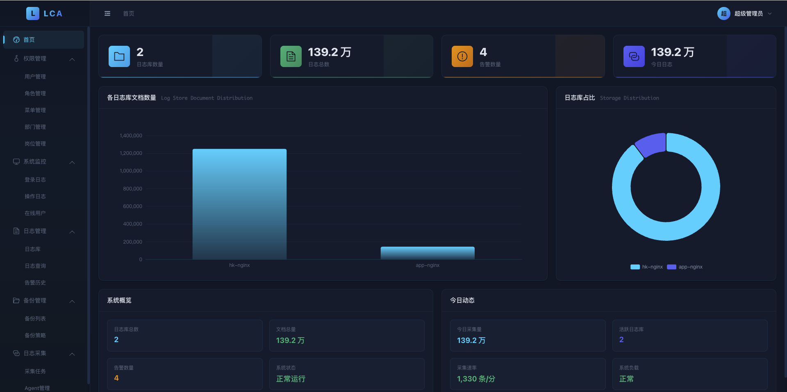
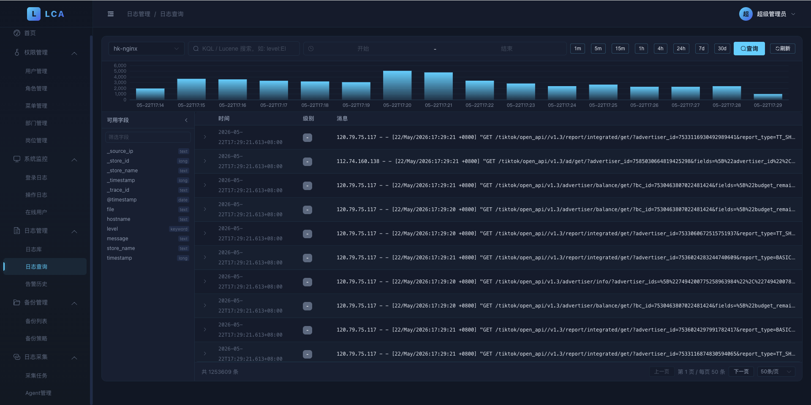
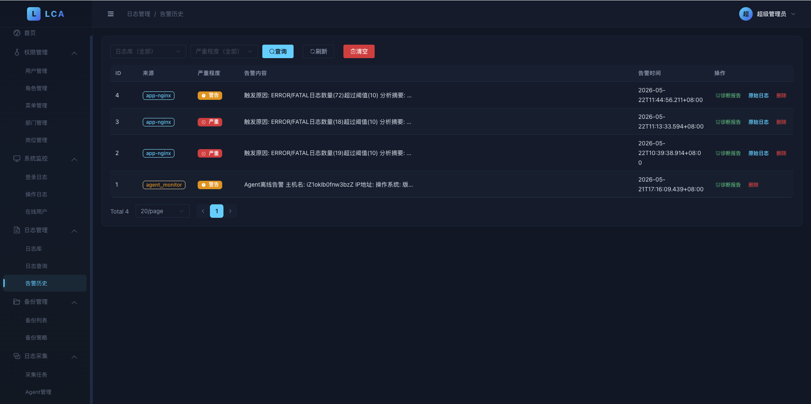
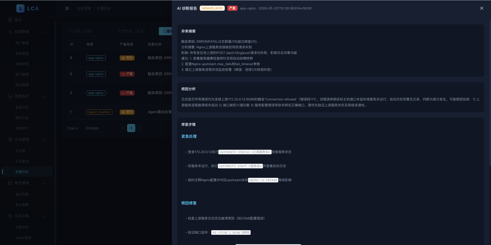
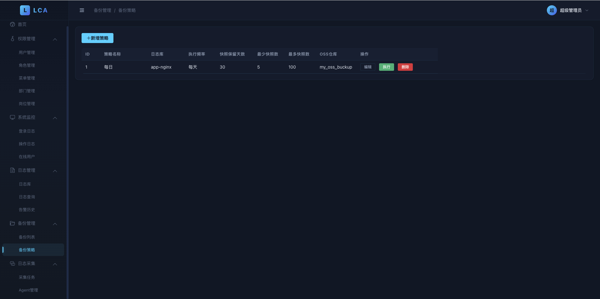
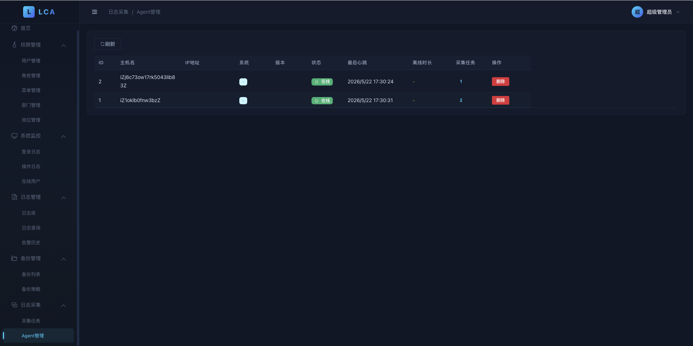
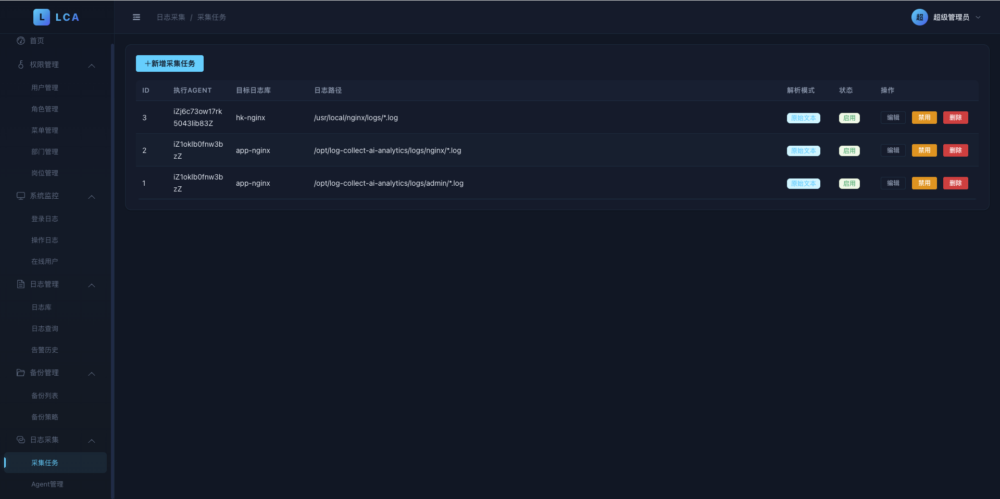
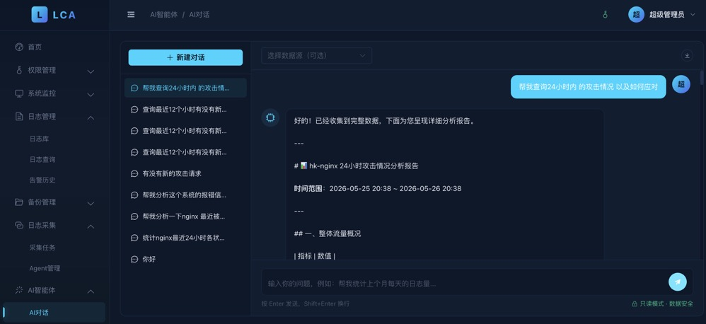

<div align="center">
  
  <h1>LCA · 日志收集智能分析系统</h1>
  <p>企业级日志采集 · 智能运维 · AI 智能告警· 实时分析 · 多渠道通知</p>

  [](LICENSE)
  [](https://golang.org)
  [](https://vuejs.org)
  [](https://www.elastic.co)

  [官网](https://lca.top) · [购买授权](https://lca.top/#pricing) · [问题反馈](https://github.com/jc2255/log-collect-ai-analytics/issues)
</div>

---

> ⚠️ **本项目为商业软件，使用需购买授权码。** 源码仅供评估参考，未经授权不得用于商业用途。详见 [LICENSE](LICENSE)。

---

## 目录

- [功能概览](#功能概览)
- [系统架构](#系统架构)
- [技术栈](#技术栈)
- [快速部署](#快速部署)
  - [单机](#单机)
  - [高可用](#高可用)
  - [从单机换到高可用](#从单机换到高可用)
- [开始使用](#开始使用)
- [各服务启动说明](#各服务启动说明)
- [配置文件详解](#配置文件详解)
- [Agent 部署](#agent-部署)
- [Syslog](#syslog)
- [API 直接投递日志](#api-直接投递日志)
- [AI 智能告警](#ai-智能告警)
- [授权码](#授权码)
- [项目结构](#项目结构)
- [故障排查](#故障排查)
- [更新日志](#更新日志)

---

## 功能概览

| 模块 | 功能描述 |
|------|---------|
| **日志采集** | 管理后台一键部署 Agent（Linux / macOS / Windows），Glob 路径，断点续传，心跳，离线通知 |
| **Syslog** | 防火墙、路由器把日志发到本机 514（UDP/TCP），按主机名分到不同日志库 |
| **API 直推** | 应用用 HTTP 批量推送，地址用宿主机 IP 或 `127.0.0.1:8086`，不要用容器名 |
| **日志传输** | Kafka 消峰削谷 → Elasticsearch，每个日志库独立 Topic |
| **服务监控** | 查看 apiserver、syslog、logtransfer、Agent 是否正常，以及各日志库是否在消费 |
| **日志查询** | 类 Kibana Discover 界面，时间直方图、字段面板、KQL 全文搜索 |
| **AI 智能告警** | ES 规则初筛 + 大模型分析。通知渠道统一配置：企业微信、钉钉、飞书、邮件、Webhook、阿里云短信 |
| **告警历史** | 所有 AI 告警 + Agent 离线告警统一记录，支持按来源 / 级别 / 状态查询 |
| **采集任务管理** | 可视化配置 Agent 采集路径、解析模式（raw/json/regex/delimiter）、多行合并 |
| **Agent 管理** | 实时心跳。超过约 3 分钟无心跳标为离线，并按已选通知渠道告警 |
| **权限管理** | 基于 Casbin RBAC，支持部门 / 岗位 / 角色 / 菜单精细化权限控制 |
| **备份管理** | 快照策略可落到本机目录或阿里云 OSS，在「备份任务」里看每次执行结果 |
| **AI智能体** | 可以根据指令智能完成相应的任务，你只需要给它发配指令就行 |
| **授权码管理** | RSA 机器指纹绑定，在线激活，防盗用 |

---

## 系统预览

### 首页 Dashboard

实时展示日志库数量、日志总量、告警数量、今日采集量；柱状图 + 环形图双视角呈现各日志库文档分布，采集速率以「条/分」精准到分钟。



### 日志查询（类 Kibana Discover）

时间直方图 + 可用字段面板 + KQL/Lucene 全文检索，支持快捷时间范围（1m / 5m / 15m / 1h / 4h / 24h / 7d / 30d）与自定义区间。



### 告警历史

统一展示 AI 告警与 Agent 离线告警记录，支持按日志库 / 严重程度过滤，一键查看「诊断报告」或「原始日志」。



### AI 智能诊断报告

大模型深度分析后给出「异常摘要 / 根因分析 / 修复步骤」三段式诊断，步骤内联合可运行命令片段，定位问题不再靠猜。



### 备份策略

可视化配置 ES 快照 SLM 策略：执行频率 / 保留天数 / 最少最多快照数 / OSS 仓库，自动备份至阿里云 OSS。



### Agent 管理

实时心跳状态跟踪，在线 / 离线一目了然，超时自动标记并邮件告警。



### 采集任务管理

为指定 Agent 动态下发采集任务：目标日志库 + Glob 路径 + 解析模式（raw / json / regex / delimiter），60 秒动态生效无需重启。



### AI智能体

可以根据指令智能完成相应的任务，你只需要给它发配指令就行。



---

## 系统架构

```
业务机器上的日志文件  →  logcollect Agent
防火墙 / 路由器        →  syslog :514
应用程序              →  HTTP /api/v1/log/push
                              ↓
                         apiserver
                              ↓
                         Kafka
                              ↓
                        logtransfer
                              ↓
                     Elasticsearch 7.x
                              ↑
                    admin + Web 管理后台
                    告警按已配置的通知渠道发出
```

### 服务说明

| 入口 | 单机 | 高可用 |
|------|------|--------|
| 管理页面 | `http://服务器IP`（80 端口） | 同左，由 Nginx 提供 |
| 日志推送 | `http://服务器IP:8086/api/v1/log/push` | `http://服务器IP/api/v1/log/push`（80 端口，不要连 8086） |
| Syslog | 服务器 IP 的 **514/UDP** 和 **514/TCP** | 同左 |
| Agent | 装在被采集的业务机器上，不随主程序启动 | 同左 |

---

## 技术栈

**后端**
- Go 1.21+ · Gin · GORM · Casbin
- MySQL 8.0 · Redis · Apache Kafka · Elasticsearch 7.x
- JWT 认证 · RSA License 验证 · Zap 日志

**前端**
- Vue 3 · TypeScript · Element Plus · Vite · ECharts

---

## 快速部署

客户使用交付包，在交付目录里执行命令即可。不需要安装 Go 或 Node，也不要在客户机器上编译。CPU 可以是 x86_64 或 aarch64。使用前请准备授权码：[购买授权](https://lca.top/#pricing)。

源码仓对内保密。要更新 GitHub 上的安装包时，在源码目录先 `make release`，再执行 `bash sync-deploy.sh`，把预编译产物同步到交付仓后自行 `git push`。交付仓里不应出现 `cmd` / `internal` / `web/src`。

`make docker-up` 和 `make docker-up-ha` 会先检查本机：

1. 没有 Docker 时执行官方安装脚本并启动服务；已经安装则跳过。
2. 把 `vm.max_map_count` 调到 `262144` 并写入 `/etc/sysctl.conf`。已经大于等于这个值则跳过。Elasticsearch 依赖这项参数，不设置会反复重启。

这两步需要 root 或 sudo。macOS 请自行安装 Docker Desktop，脚本不会在 Mac 上改内核参数。

防火墙至少放行：

| 端口 | 用途 |
|------|------|
| 80/TCP | 管理页面。高可用时日志推送也走这个端口 |
| 8086/TCP | 仅单机：日志推送 |
| 514/UDP、514/TCP | 防火墙、路由器 Syslog |

3306、6379、9092、9200 只在本机使用，不要对公网开放。

```bash
cp .env.example .env
# 至少改 JWT_SECRET。生产环境同时改 MYSQL_ROOT_PASSWORD、REDIS_PASSWORD
```

### 单机

适合试用和日志量不大的环境。MySQL、Redis、Kafka、Elasticsearch 和各应用各一个实例。

```bash
make docker-up
```

浏览器打开 **http://服务器IP**。默认账号 `admin`，默认密码 `admin123`。登录后立即修改密码。

本机自检：

```bash
curl -fsS http://127.0.0.1/health
curl -fsS http://127.0.0.1:8086/health
```

### 高可用

适合生产。压力大的链路做了冗余，其余组件保持单实例。

| 组件 | 高可用里的实例 |
|------|----------------|
| Kafka | 3 个 Broker |
| Elasticsearch | 3 个节点 |
| apiserver | 2 个，由 Nginx 转发 `/api/v1/log/push` |
| MySQL、Redis、admin、logtransfer、syslog | 各 1 个 |

页面、管理接口、日志推送都从 **80** 端口进入。apiserver 不单独映射 8086。三台 Elasticsearch 会各占一份内存，机器紧张时先在 `.env` 里调 `ES_JAVA_OPTS`，再启动。

这台机器上还没有 LCA 容器时：

```bash
make docker-up-ha
docker compose -f docker-compose.ha.yaml ps
```

看日志：

```bash
docker compose -f docker-compose.ha.yaml logs -f admin
docker compose -f docker-compose.ha.yaml logs -f apiserver1
```

### 从单机换到高可用

不能只停容器再启动高可用。单机和高可用的 Elasticsearch 不是同一份数据：单机用 `es_data`，高可用是全新的 `es01_data` / `es02_data` / `es03_data`。MySQL 和 Redis 却共用 `mysql_data`、`redis_data`。旧库里的日志库（例如 `monitoring`）还在，新集群里没有对应索引，日志查询就会报 `no such index`。

切换时要让 MySQL、Redis 回到初始状态。镜像仍然保留。

```bash
make docker-switch-ha
make docker-up-ha
```

`make docker-switch-ha` 会停掉单机和高可用的容器，并删除本项目的 MySQL、Redis 数据卷。高可用自己的 Kafka、ES 数据卷不动。授权码在 MySQL 里，启动后需要重新激活；机器 ID 还在 `data/admin`，原来的授权码可以继续用。

`make docker-rm` 只删容器，不会清数据库，不能用来切高可用。`make docker-clean` 会连本地镜像一起删，也不要用来切换。

---

## 开始使用

登录后如果弹出授权窗口，把机器 ID 复制到 [lca.top](https://lca.top) 生成授权码，粘贴后点激活。未激活时业务菜单不可用。机器 ID 写在交付目录的 `data/admin` 里，不要删这个目录，否则要重新授权。以后要看授权，点页面右上角的授权标识。

建议按下面的顺序接日志。

### 1. 先建日志库

打开「日志管理 → 日志库」，新建一个库，记下名称和 API Key。文件采集、Syslog、HTTP 推送都靠这把 Key 决定日志进哪个库。

### 2. 选一种方式把日志送进来

三种可以同时用。

**服务器上的文件。** 打开「系统监控 → 服务监控」，在 Agent 一键部署里选本机、内网或外网，把命令复制到目标机器执行。Linux、macOS、Windows 都可以，安装的是交付包里的预编译程序。再到「日志采集 → 采集任务」填写真实路径，例如 `/var/log/nginx/*.log`。路径里如果写成字面量 `Y-M-D`，一个文件都匹配不到。任务详情里可以看到有没有在采集、路径是否匹配、当前速率。

**防火墙和路由器。** 在设备上把 Syslog 服务器填成 LCA 这台机器的 IP，端口 `514`，协议 UDP 或 TCP。回到「服务监控」，打开 `lca-syslog` 详情，按主机名把每台设备分到日志库并保存。同一来源 IP 下主机名不同会分成多台；设备在 NAT 后面时经常是这样。每台设备有独立 IP 时，来源 IP 也会分开。

**应用程序直接推送。** 单机、并且命令就在 LCA 这台机器上执行时：

```bash
curl -X POST 'http://127.0.0.1:8086/api/v1/log/push' \
  -H 'Content-Type: application/json' \
  -d '{
    "api_key": "日志库的 API Key",
    "logs": [
      { "message": "hello from curl", "level": "INFO" }
    ]
  }'
```

别的机器推到单机时，把地址换成 `http://服务器IP:8086/api/v1/log/push`。高可用没有对外的 8086，改成 `http://服务器IP/api/v1/log/push`。

`lca-apiserver` 只在 Docker 网络内部能解析。在宿主机或业务机器上用这个名字会失败。服务监控里 `lca-apiserver` 详情中的 curl 已经是宿主机地址，选好日志库后直接复制。

成功时返回 `"code": 0`。返回里的 `trace_id` 可以用来追查这条日志走到了哪一步。

### 3. 到日志查询里确认

打开「日志管理 → 日志查询」，日志库选刚才接入的那一个，时间选今天。查询会同时看该库的当前索引和按天滚动的索引。

### 4. 看服务是否在消费

「系统监控 → 服务监控」：

- `lca-apiserver`：接入是否正常，详情里有可复制的 curl。
- `lca-syslog`：哪些设备已连接，各自进哪个日志库。
- `lca-logtransfer`：每个日志库是否在消费、积压多少。有积压但速率为 0 时，先看这里的原因。
- `logcollect`：Agent 在线数量。离线时用同一页的部署命令重新安装。

### 5. 再配告警和备份

先到「告警管理 → 通知渠道管理」配好企业微信、钉钉、飞书、邮件、Webhook 或阿里云短信，并用测试按钮确认能发出去。告警规则、日志库上的 AI 告警、Agent 离线通知只选择渠道。

备份在「备份管理」。策略保存后到「备份任务」看进度和结果。本地备份的文件在 Elasticsearch 容器内的 `/data/backups/仓库名`。执行时间按 Linux 五段 cron 填写，例如每天凌晨 2 点是 `0 2 * * *`。

---

## 各服务启动说明

客户环境用 `make docker-up` 或 `make docker-up-ha`，不需要按下面的顺序手工拉起进程。这段用来对照某个容器没起来时，它依赖谁。

### 推荐启动顺序

```
1. MySQL / Redis / Kafka / Elasticsearch  ← 基础设施
2. admin          ← 管理后台，负责建表和初始数据
3. apiserver      ← 日志接入，依赖 MySQL + Kafka
4. logtransfer    ← 数据传输，依赖 Kafka + ES
5. logcollect     ← 采集 Agent（部署在各业务机器上）
```

### 使用 systemd 托管

不用 Docker、要自己托管进程时才需要。生产环境优先用上面的 Docker 命令。

以 `admin` 服务为例：

```ini
# /etc/systemd/system/lca-admin.service
[Unit]
Description=LCA Admin Server
After=network.target mysql.service

[Service]
Type=simple
User=www-data
WorkingDirectory=/opt/lca
ExecStart=/opt/lca/bin/admin -config /opt/lca/configs/admin.yaml
Restart=always
RestartSec=5

[Install]
WantedBy=multi-user.target
```

```bash
systemctl daemon-reload
systemctl enable lca-admin
systemctl start lca-admin
systemctl status lca-admin
```

### 健康检查接口

单机：

```bash
curl -fsS http://127.0.0.1/health          # 页面入口
curl -fsS http://127.0.0.1:8080/health     # admin
curl -fsS http://127.0.0.1:8086/health     # apiserver
```

高可用的页面和日志推送都在 80 端口，admin、apiserver 没有映射到宿主机：

```bash
curl -fsS http://127.0.0.1/health
```

---

## 配置文件详解

### configs/admin.yaml

```yaml
server:
  port: 8080          # 管理后台端口
  mode: release       # debug / release

mysql:
  host: 127.0.0.1
  port: 3306
  user: root
  password: "lca2024"
  dbname: lca

redis:
  host: 127.0.0.1
  port: 6379
  password: "lca2024"

kafka:
  brokers:
    - "127.0.0.1:9092"

elasticsearch:
  addresses:
    - "http://127.0.0.1:9200"
  username: ""   # ES 有密码时填写
  password: ""

jwt:
  secret: "change-this-secret-in-production"  # 必须修改！
  expire_hour: 24

log:
  level: info
  filename: logs/admin.log   # 留空则输出到 stdout

license:
  public_key: |               # RSA 公钥，用于验证授权码
    -----BEGIN PUBLIC KEY-----
    ...
    -----END PUBLIC KEY-----
```

### configs/apiserver.yaml

```yaml
server:
  port: 8086   # 日志接入端口，Agent 和直推 API 均使用此端口

# 其余配置同 admin.yaml
```

### configs/logcollect.yaml（Agent 配置）

```yaml
api_server: "http://your-apiserver"   # apiserver 地址
admin_server: "http://your-admin"     # admin 地址，用于拉取采集任务
api_key: "ak_your_logstore_xxx"            # 日志库的 API Key（在日志库页面查看）
agent_id: "server-prod-001"               # 当前机器的唯一标识
batch_size: 50                             # 批量发送条数
flush_seconds: 5                           # 最大积攒秒数（超时强制发送）
```

---

## Agent 部署

采集程序装在业务机器上，不在 LCA 的 Docker 里。

1. 管理后台打开「系统监控 → 服务监控」。
2. 在「Agent 一键部署」选择网络：业务机和 LCA 在同一台机器上选「本机」；在同一内网选「内网其它机器」并确认 IP；在公网选「外网」。
3. 选择 Linux 或 Windows。Linux 再选 amd64 或 arm64，macOS 会在脚本里自动识别。
4. 把命令复制到目标机器执行。脚本从本平台下载预编译程序，不需要源码。Linux 会注册成 systemd 服务 `lca-agent`：进程退出后自动重启，开机也会自启。macOS 没有 systemd，只会后台启动。
5. 回到「日志采集 → 采集任务」添加任务。路径用真实 glob，例如 `/var/log/app/*.log`。
6. 在任务详情里确认「正在采集」。若显示路径未匹配，改路径后再等约 60 秒，Agent 会自己拉新任务。

Agent 超过约 3 分钟没有心跳会标成离线。离线通知在 Agent 管理里选择已建好的通知渠道。

---

## Syslog

防火墙、路由器不要再单独装一套接收程序。`make docker-up` 或 `make docker-up-ha` 已经在宿主机 **514** 上听 UDP 和 TCP。

1. 设备的 Syslog 服务器填 LCA 机器的 IP，端口 `514`。
2. 打开「系统监控 → 服务监控 → lca-syslog」。
3. 在已连接设备里按主机名选择日志库，点保存。
4. 到「日志查询」选这个日志库，时间选今天。

同一来源 IP 上，报文主机名不同就是不同设备，可以分到不同日志库。没单独保存过的设备，沿用这个 IP 上已经保存的分配。

模拟多台设备可以在 LCA 机器上执行：

```bash
bash scripts/simulate-syslog.sh
```

从本机打进 Docker 时，来源 IP 通常是网桥地址，四台设备会显示成同一个 IP、四个主机名。这是正常现象。

---

## API 直接投递日志

不装 Agent 时，应用用 HTTP 把日志推进来。地址按部署方式选，不要用容器名 `lca-apiserver`。

| 谁在推 | 地址 |
|--------|------|
| 单机，命令在 LCA 本机执行 | `http://127.0.0.1:8086/api/v1/log/push` |
| 单机，别的机器来推 | `http://服务器IP:8086/api/v1/log/push` |
| 高可用 | `http://服务器IP/api/v1/log/push` |

管理后台「服务监控 → lca-apiserver → 详情」里有带好 API Key 的 curl，优先复制那里的命令。

### 接口说明

```
POST /api/v1/log/push
Content-Type: application/json
X-Trace-Id: <16位 hex>      // 可选，不传服务端会自动生成

{
  "api_key": "ak_your_logstore_xxx",  // 日志库的 API Key（必填）
  "logs": [                            // 日志数组（必填，支持批量）
    { ... },
    { ... }
  ]
}
```

**响应体：**
```json
{
  "code": 0,
  "message": "success",
  "data": {
    "count": 1,
    "trace_id": "7eae7b75176463bd"   // 全链路追踪 ID，后续问题定位仅需提供该 ID
  }
}
```

响应 Header 也会携带 `X-Trace-Id`；同一条日志在 apiserver / Kafka / logtransfer / ES 中均可通过该 ID 串联。

每条日志可以是任意 JSON 对象，系统会自动附加以下字段：
- `_timestamp`：Unix 毫秒时间戳
- `_source_ip`：推送方 IP
- `_store_name`：日志库名称
- `_trace_id`：全链路追踪 ID（便于事后 ES 检索）

---

### curl 示例

#### 1. 推送单条原始日志

```bash
curl -X POST http://127.0.0.1:8086/api/v1/log/push \
  -H "Content-Type: application/json" \
  -d '{
    "api_key": "ak_app-nginx_a1b2c3d4",
    "logs": [
      {
        "@timestamp": "2026-05-18T10:30:00Z",
        "message": "GET /api/users 200 125ms",
        "level": "INFO"
      }
    ]
  }'
```

#### 2. 批量推送多条日志

```bash
curl -X POST http://127.0.0.1:8086/api/v1/log/push \
  -H "Content-Type: application/json" \
  -d '{
    "api_key": "ak_app-nginx_a1b2c3d4",
    "logs": [
      {
        "@timestamp": "2026-05-18T10:30:01Z",
        "message": "192.168.1.1 - GET /index.html 200 1234",
        "level": "INFO",
        "host": "web-01"
      },
      {
        "@timestamp": "2026-05-18T10:30:02Z",
        "message": "192.168.1.2 - POST /api/login 401 56",
        "level": "WARN",
        "host": "web-01"
      },
      {
        "@timestamp": "2026-05-18T10:30:03Z",
        "message": "Connection refused: database unreachable",
        "level": "ERROR",
        "host": "web-01",
        "service": "user-service"
      }
    ]
  }'
```

#### 3. 推送结构化 JSON 日志（Java / Go / Python 应用）

```bash
curl -X POST http://127.0.0.1:8086/api/v1/log/push \
  -H "Content-Type: application/json" \
  -d '{
    "api_key": "ak_app-backend_b5c6d7e8",
    "logs": [
      {
        "@timestamp": "2026-05-18T10:31:00Z",
        "level": "ERROR",
        "logger": "com.example.UserService",
        "message": "Failed to save user",
        "thread": "http-nio-8080-exec-3",
        "traceId": "abc123def456",
        "userId": 1001,
        "exception": "java.sql.SQLException: Timeout waiting for connection from pool"
      }
    ]
  }'
```

#### 4. 推送 Nginx 访问日志（格式化为 JSON）

```bash
# 假设 Nginx 配置了 JSON 格式日志
curl -X POST http://127.0.0.1:8086/api/v1/log/push \
  -H "Content-Type: application/json" \
  -d '{
    "api_key": "ak_app-nginx_a1b2c3d4",
    "logs": [
      {
        "@timestamp": "2026-05-18T10:32:00+08:00",
        "remote_addr": "1.2.3.4",
        "request": "GET /api/v1/users HTTP/1.1",
        "status": 200,
        "body_bytes_sent": 1234,
        "request_time": 0.125,
        "http_user_agent": "Mozilla/5.0",
        "http_referer": "https://example.com"
      }
    ]
  }'
```

#### 5. 返回示例

```json
{
  "code": 0,
  "msg": "success",
  "data": {
    "count": 3
  }
}
```

---

下面示例按单机来写。高可用把地址换成 `http://服务器IP/api/v1/log/push`。

### Shell 脚本持续推送示例

```bash
#!/bin/bash
# 实时推送应用日志到 LCA
API_URL="http://127.0.0.1:8086/api/v1/log/push"
API_KEY="ak_app-backend_b5c6d7e8"
LOG_FILE="/var/log/app/app.log"

tail -F "$LOG_FILE" | while IFS= read -r line; do
  TIMESTAMP=$(date -u +"%Y-%m-%dT%H:%M:%SZ")
  curl -s -X POST "$API_URL" \
    -H "Content-Type: application/json" \
    -d "{\"api_key\":\"$API_KEY\",\"logs\":[{\"@timestamp\":\"$TIMESTAMP\",\"message\":$(echo "$line" | python3 -c 'import json,sys; print(json.dumps(sys.stdin.read().strip()))')}]}" \
    > /dev/null
done
```

---

### Python 集成示例

```python
import requests
import json
from datetime import datetime, timezone

LCA_URL = "http://127.0.0.1:8086/api/v1/log/push"
API_KEY = "ak_app-backend_b5c6d7e8"

def push_log(level: str, message: str, **extra):
    payload = {
        "api_key": API_KEY,
        "logs": [{
            "@timestamp": datetime.now(timezone.utc).isoformat(),
            "level": level,
            "message": message,
            **extra
        }]
    }
    try:
        resp = requests.post(LCA_URL, json=payload, timeout=5)
        return resp.json()
    except Exception as e:
        print(f"[LCA] push failed: {e}")

# 使用示例
push_log("INFO", "User login successful", user_id=1001, ip="1.2.3.4")
push_log("ERROR", "Database connection failed", service="user-service", retry=3)
```

---

### Logstash 对接示例

在 Logstash pipeline 中使用 `http` output 直接将日志推送到 LCA：

```ruby
output {
  http {
    url    => "http://127.0.0.1:8086/api/v1/log/push"
    format => "json"
    http_method => "post"
    mapping => {
      "api_key" => "ak_app-nginx_a1b2c3d4"
      "logs" => ["%{[@metadata][event]}"]
    }
  }
}
```

---

## AI 智能告警

在「日志管理 → 日志库」列表页开启「AI 智能告警」开关，点击「配置」进行设置。

### 配置参数说明

| 参数 | 说明 | 示例 |
|------|------|------|
| 扫描间隔 | 多少分钟扫描一次 | `5` |
| ERROR 阈值 | 近期 ERROR/FATAL 数量超过此值触发告警 | `10` |
| 关键词 | 命中任意关键词超过 5 次也触发告警 | `OOM、Connection refused` |
| LLM 提供商 | openai / deepseek / qwen / ollama | `deepseek` |
| LLM API Key | 大模型 API 密钥 | `sk-xxx` |
| LLM Base URL | API 地址（OpenAI 兼容格式） | `https://api.deepseek.com/v1` |
| 静默期 | 同一日志库告警后多少分钟内不再重复告警 | `60` |
| 通知渠道 | 在「告警管理 → 通知渠道管理」里先建好，这里只选择 | 企业微信、钉钉、飞书、邮件、Webhook、阿里云短信 |

### 通知渠道配置

渠道只在「告警管理 → 通知渠道管理」里维护。告警规则、日志库 AI 告警、Agent 离线通知都是选择已有渠道。

| 渠道 | 需要的参数 |
|------|-----------|
| 企业微信机器人 | Webhook URL |
| 钉钉机器人 | Webhook URL |
| 飞书机器人 | Webhook URL |
| 邮件 | SMTP 服务器、端口、账号、密码、收件人 |
| 自定义 Webhook | URL |
| 阿里云短信 | AccessKey、签名、模板。短信内容对应模板变量，注意长度限制 |

**邮件配置说明：**
- QQ邮箱：`smtp.qq.com`，端口 `465`（SSL），密码为授权码
- 163邮箱：`smtp.163.com`，端口 `465`（SSL）
- Gmail：`smtp.gmail.com`，端口 `587`（STARTTLS）

### 支持的大模型

| 提供商 | API Base URL | 推荐模型 |
|--------|-------------|---------|
| DeepSeek | `https://api.deepseek.com/v1` | `deepseek-chat` |
| 阿里通义千问 | `https://dashscope.aliyuncs.com/compatible-mode/v1` | `qwen-plus` |
| OpenAI | `https://api.openai.com/v1` | `gpt-4o-mini` |
| Ollama（本地） | `http://localhost:11434/v1` | `llama3` |

### Agent 离线通知

当 Agent 超过约 3 分钟没有心跳时，系统会把该 Agent 标成离线，并在「告警历史」里留下记录。要收到通知，先在「告警管理 → 通知渠道管理」建好渠道，再在 Agent 管理的离线通知里选中这些渠道。

---

## 授权码

本系统使用 **RSA 机器指纹绑定**授权机制，防止授权码跨机器使用。

### 激活步骤

1. 用 `admin` / `admin123` 登录。未激活时会直接弹出授权窗口；已激活后点右上角授权标识。
2. 复制窗口里的机器 ID，到 [lca.top](https://lca.top) 生成授权码。
3. 把授权码粘贴到输入框，点「激活授权码」。
4. 机器 ID 保存在交付目录的 `data/admin`。迁移服务器时带上这个目录，或在新机器上重新申请授权码。

### 版本说明

| 版本 | 适用场景 | 授权码 |
|------|---------|--------|
| Community | 个人非商业用途，部分功能受限 | 免费申请 |
| Professional | 商业用途，单机部署 | 付费购买 |
| Enterprise | 商业用途，多机部署 + 优先技术支持 | 联系商务 |

> 购买地址：**https://lca.top** · 商务咨询：**13925090458**

---

## 项目结构

```
log-collect-ai-analytics/
├── cmd/                        # 各服务可执行入口
│   ├── admin/                  # 管理后台服务
│   ├── apiserver/              # 日志接入服务（HTTP Push）
│   ├── logcollect/             # Linux/macOS 采集 Agent
│   ├── logcollect_win/         # Windows 采集 Agent
│   ├── logtransfer/            # Kafka → Elasticsearch 传输服务
│   └── syslog/                 # Syslog 接收服务（UDP 514）
├── configs/                    # 配置文件
│   ├── admin.yaml              # 管理后台配置
│   ├── apiserver.yaml          # 日志接入服务配置
│   ├── logtransfer.yaml        # 传输服务配置
│   ├── logcollect.yaml         # Agent 配置
│   └── rbac_model.conf         # Casbin RBAC 模型定义
├── deploy/                     # Docker 构建文件
│   ├── Dockerfile              # 后端镜像
│   ├── Dockerfile.web          # 前端镜像
│   ├── nginx.conf              # Nginx 反向代理配置
│   └── ha/                     # 高可用部署配置
│       ├── nginx-ha.conf       # Nginx 负载均衡配置
│       ├── sentinel.conf       # Redis Sentinel 配置
│       ├── mysql-master.cnf    # MySQL 主库配置
│       └── mysql-slave.cnf     # MySQL 从库配置
├── internal/
│   ├── handler/                # HTTP 处理器（各业务模块）
│   ├── middleware/             # 中间件（JWT / RBAC / License / 审计日志）
│   ├── model/                  # GORM 数据模型
│   ├── pkg/                    # 公共包（ES / Kafka / Redis / Config / Logger）
│   └── service/                # 业务服务
│       ├── ai_alert_scanner.go         # AI 告警规则扫描
│       ├── ai_alert_notifier.go        # 多渠道通知发送
│       ├── ai_alert_llm.go             # 大模型调用
│       ├── ai_alert_scheduler.go       # 定时调度器
│       └── agent_offline_notifier.go   # Agent 离线检测 & 邮件通知
├── keys/                       # RSA 公钥（私钥不入库！）
├── scripts/
│   ├── init-ha.sh             # HA 基础设施初始化脚本
│   └── start.sh                # 一键启动脚本
├── web/                        # Vue 3 前端工程
│   ├── src/
│   │   ├── api/                # 后端 API 封装
│   │   ├── views/              # 页面组件
│   │   │   ├── log/            # 日志管理（日志库、日志查询、告警历史）
│   │   │   ├── collect/        # 采集任务管理、Agent 管理
│   │   │   ├── monitor/        # 系统监控（登录日志、操作日志、在线用户）
│   │   │   ├── permission/     # 权限管理
│   │   │   ├── backup/         # 备份管理
│   │   │   └── dashboard/      # 首页统计
│   │   └── layouts/            # 主布局
│   └── dist/                   # 构建产物（由 admin 服务托管）
└── docker-compose.ha.yaml      # 高可用部署编排
```

---

## 故障排查

### 页面 502 或登录验证码不出现

高可用部署下，前端静态资源与验证码接口都经 Nginx 转发。出现 **502**、登录页**验证码空白/不加载**时，先重建并重启 Nginx（不牵动其它服务）：

```bash
docker compose -f docker-compose.ha.yaml up -d --build --no-deps nginx
```

仍异常时再查：`docker compose -f docker-compose.ha.yaml logs nginx admin`，并确认 `release/web-dist` 已是最新前端产物。

### 使用 trace_id 定位问题（推荐）

所有走 `/api/v1/log/push` 的请求会获得一个全链路 `trace_id`，同一条日志在 4 个组件中均可以该 ID 串联。出问题时，只需拿到 trace_id 后依次类似以下检索：

```bash
TRACE=<响应中返回的 trace_id>

# 1) apiserver 是否接收并写入 Kafka
docker logs lca-apiserver1 lca-apiserver2 2>&1 | grep "trace=$TRACE"
# 期望：recv push → api_key OK → kafka write OK

# 2) logtransfer 是否从 Kafka 拉到并写入 ES
docker logs lca-logtransfer 2>&1 | grep "trace=$TRACE"
# 期望：fetch → flush start → flush OK

# 3) ES 是否落库（索引名以 logtransfer “flush OK” 日志中输出为准）
curl -sS "http://localhost:9200/<真实索引名>/_search?q=_trace_id:$TRACE&pretty"
```

**进一步按初步表现决定排查方向：**

| 初步表现 | 可能原因 |
|---|---|
| apiserver 不出 trace 日志 | nginx 未调到该 apiserver / agent 未推到服务端 |
| apiserver 有、logtransfer 无 | Kafka topic / partition 未分配、consumer group 未 join（查 `kafka-consumer-groups.sh --describe`） |
| logtransfer 出 fetch 但无 flush OK | ES 连接问题、index 写入被拒 |
| logtransfer flush OK 但 ES 查不到 | 查询索引名拼错（以“`flush OK index=...`”日志为准） |

### Kafka HA 集群 `Group Coordinator Not Available`

现象：consumer 反复报 `[15] Group Coordinator Not Available`，`__consumer_offsets` 不存在。

原因：Kafka 默认 `offsets.topic.replication.factor=1`，与 `min.insync.replicas=2` 冲突，`__consumer_offsets` 创建后不可写。

修复：`docker-compose.ha.yaml` 中 3 个 Kafka broker 均需加上：

```yaml
KAFKA_OFFSETS_TOPIC_REPLICATION_FACTOR: 3
KAFKA_TRANSACTION_STATE_LOG_REPLICATION_FACTOR: 3
KAFKA_TRANSACTION_STATE_LOG_MIN_ISR: 2
```

修改后 `docker compose -f docker-compose.ha.yaml up -d --force-recreate kafka1 kafka2 kafka3`。

### 镜像代码不生效

`deploy/Dockerfile` 采用 `COPY release/bin/${APP_NAME} ./server`，**二进制嵌入镜像**。重新编译后必须：

```bash
docker compose -f docker-compose.ha.yaml build --no-cache <service>
docker compose -f docker-compose.ha.yaml up -d --force-recreate <service>
```

单纯 `up -d --force-recreate` **不会**重新打包镜像。

---
### AI配置 configs/admin-ha.yaml 找到 ai配置即可

## 更新日志

### v1.3.1
- 新增**全链路 trace_id 追踪**：agent → apiserver → Kafka → logtransfer → ES 同一条日志共享一个 `X-Trace-Id`，后续问题定位只需提供该 ID
- HTTP 响应体 / Header / Kafka Header / ES `_trace_id` 字段多点透传
- 修复 Kafka HA 集群 `__consumer_offsets` 创建失败问题（`OFFSETS_TOPIC_REPLICATION_FACTOR` 与 `MIN_INSYNC_REPLICAS` 匹配）
- kafka-go Reader 统一接入 ErrorLogger，group join / sync 错误不再静默吃掉
- logtransfer flush 日志从 debug 升为 info，默认可见

### v1.3.0
- 新增高可用部署：Kafka 3 Broker、Elasticsearch 3 节点、apiserver 双实例，入口由 Nginx 转发。MySQL、Redis、admin、logtransfer、syslog 仍是单实例
- 新增分布式锁（Redis SETNX + Lua），保障多实例下定时任务互斥执行
- 新增 Leader Election 机制，AI 告警调度器、Agent 离线检测自动主备切换
- 新增 Casbin 策略多实例同步（Redis Pub/Sub），权限变更实时生效
- 新增 Nginx 负载均衡配置，upstream 健康检查 + 故障自动转发
- 新增一键 HA 初始化脚本（`scripts/init-ha.sh`）

### v1.2.0
- 新增「告警历史」列表页，统一展示 AI 告警 + Agent 离线告警记录
- 新增 Agent 离线自动检测，3 分钟超时标记离线并邮件通知管理员
- 告警历史支持按日志库 / 严重程度 / 状态过滤、单条删除、批量清空

### v1.1.0
- 新增 AI 智能告警（ES 规则初筛 + 大模型深度分析）
- 支持企业微信 / 钉钉 / 邮件（SSL 465 / STARTTLS 587）/ Webhook 多渠道通知
- 告警静默期配置，防止告警风暴

### v1.0.0
- 日志采集 Agent（Linux/Windows），断点续传，60 秒动态拉取任务
- 日志库管理、采集任务管理
- 类 Kibana 日志查询界面（时间直方图 + 字段面板 + KQL）
- API 直接推送（任意应用 HTTP 接入，无需 Agent）
- RBAC 权限管理（部门 / 岗位 / 角色 / 菜单）
- ES 快照备份管理（阿里云 OSS）
- RSA 机器指纹 License 授权码机制

---

<div align="center">
  <p>Copyright © 2024-2026 LCA Software. All Rights Reserved.</p>
  <p>
    <a href="https://lca.top">官网</a> ·
    <a href="https://lca.top/#pricing">购买授权</a> ·
    <a href="mailto:1684350829@qq.com">联系我们</a>
  </p>
</div>
